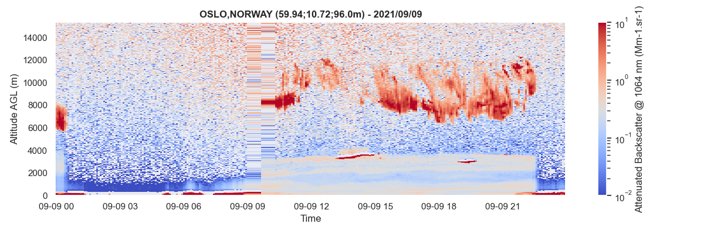
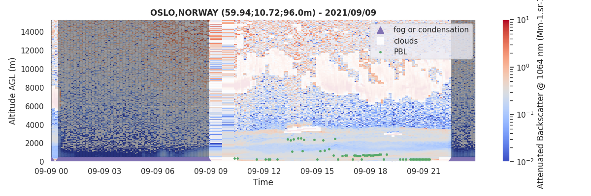
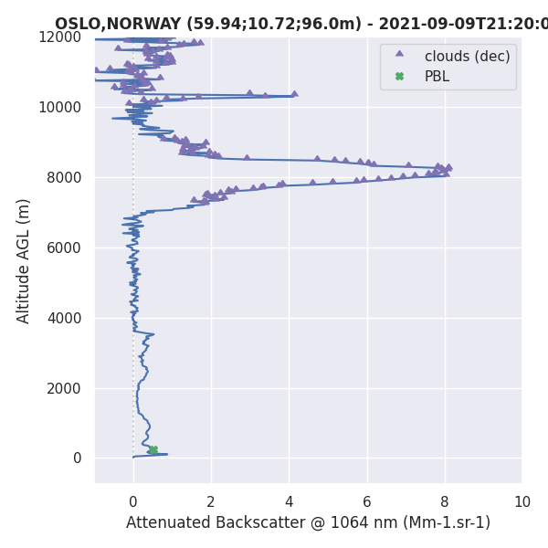

[](https://github.com/AugustinMortier/A-Profiles/actions/workflows/ci.yml)
[](https://augustinmortier.github.io/a-profiles/)
[](https://codecov.io/gh/AugustinMortier/A-Profiles)


Python library for reading and processing ALC (Automated Lidars and Ceilometers) measurements. A-Profiles supports [E-PROFILE](https://e-profile.eu/#/cm_profile) ceilometer data. This library is used by [V-Profiles](https://vprofiles.met.no).

## 📗 Documentation
The official documentation is available [here](https://augustinmortier.github.io/a-profiles/).

## ✨ Installation

### Install from PyPI

Use Python **3.11–3.15**. Install packages in a virtual environment rather than into your system Python; this keeps project dependencies isolated.

Create an environment in the project directory:

```shell
python -m venv .venv
```

Activate it using the command for your shell:

```shell
# macOS / Linux
source .venv/bin/activate
```

```powershell
# Windows PowerShell
.venv\Scripts\Activate.ps1
```

Then install A-Profiles:

```shell
python -m pip install --upgrade pip
python -m pip install aprofiles
```

Using `python -m pip` ensures pip installs into the selected environment. If you use [uv](https://docs.astral.sh/uv/), create and activate a virtual environment, then run `uv pip install aprofiles`.

### Install the command-line interface

The `apro` command is an optional extra. To use it in the environment above, install:

```shell
python -m pip install "aprofiles[cli]"
```

For a standalone CLI installation, [pipx](https://pipx.pypa.io/) creates and manages an isolated environment for you:

```shell
pipx install "aprofiles[cli]"
```

### Install from source

```shell
git clone https://github.com/AugustinMortier/A-Profiles.git
cd A-Profiles
python -m venv .venv
```

Activate `.venv` using the command for your shell above, then install:

```shell
python -m pip install .
```

For development, install the package in editable mode with its development, documentation, and CLI dependencies:

```shell
python -m pip install -e ".[dev,docs,cli]"
```

## 🚀 Get started

### Reading Data
```python
# import library
import aprofiles as apro

# read local NetCDF L2 data
path = "examples/data/E-PROFILE/L2_0-20000-006735_A20210908.nc"
profiles = apro.reader.ReadProfiles(path).read()
``` 

### Basic corrections and Image plotting
```python
# extrapolate lowest layers for removing outliers
profiles.extrapolate_below(z=150, inplace=True)

# image plotting of backscatter signal in log scale
profiles.plot(zref='agl', vmin=1e-2, vmax=1e1, log=True)
``` 



### Profiles Analysis
```python
# fog/condensation detection
profiles.foc(zmin_cloud=200) 

# clouds detection
profiles.clouds()

# planetary boundary layer
profiles.pbl(zmin=200, zmax=3000, under_clouds=True)
```

### Visualization

#### Image
```python
# image plotting with additional retrievals
profiles.plot(show_fog=True, show_clouds=True, show_pbl=True, vmin=1e-2, vmax=1e1, log=True)
```


##### Single Profile
```python
# plot single profile at 21:20
datetime = np.datetime64('2021-09-09T21:20:00')
profiles.plot(datetime=datetime, vmin=-1, vmax=10, zmax=12000, show_clouds=True, show_pbl=True)
```


## ⚖️ License
[GPL-3.0](LICENSE).

## 🎓 Support
*A-Profiles* is developed by [MET Norway](https://github.com/metno) and supported by [EUMETNET](https://www.eumetnet.eu/).
